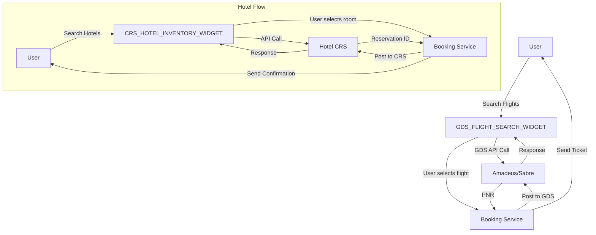

# Enterprise Travel Portal – Direct GDS/CRS Integration & Conversion Guide  
*Authoritative technical specification for white‑label direct booking of flights & hotels*  

---  

## 1. Executive Summary  

This guide outlines how an enterprise travel platform can consume **live, direct GDS/CRS data** from Amadeus/Sabre for airline schedules and real‑time cabin class availability, and from your CRS for hotel inventory and pricing.  
All data flows **directly from the GDS/CRS** – no affiliate or commission links – ensuring the most accurate, up‑to‑date rates and inventory for your customers.  

The document covers:  

* Architecture & data flow  
* Flight availability, pricing and booking workflow  
* Hotel inventory, rates and booking workflow  
* White‑label widget integration points  
* Security & compliance checklist  
* Conversion‑oriented UI/UX best practices  

> **Note** – This document is intended for developers, product managers, and technical architects building or extending a white‑label travel portal.  

---  

## 2. High‑Level Architecture  

```
+-------------------------------------------------+
|                Enterprise Travel Portal        |
|  (White‑label UI + Business Logic Layer)        |
|   |                     |                      |
|   |  GDS_FLIGHT_SEARCH_WIDGET  |  CRS_HOTEL_INVENTORY_WIDGET |
|   |                     |                      |
+---------+---------------+-----------------------+
          |               |
          |  REST/GraphQL  |
          |               |
+----------------+-----------------------+
|   Direct GDS / CRS Connections             |
|  (Amadeus, Sabre, Hotel CRS)                |
|   - Flight Availability/Price (APIs)        |
|   - Hotel Availability/Price (APIs)         |
+--------------------------------------------+
```

* **White‑label widgets** (see §4) embed the UI in your brand while the core logic calls the GDS/CRS APIs.  
* All data is fetched in **real time** and rendered immediately.  

---  

## 3. Flight Data Integration  

### 3.1 Core Concepts

| Term | Description |
|------|-------------|
| **Segment** | A single leg of a trip (e.g., IST→LHR). |
| **Itinerary** | One or more segments forming a round‑trip or multi‑city. |
| **Cabin Class** | e.g., Economy (Y), Premium Economy (W), Business (J), First (F). |
| **Fare Basis Code** | 3‑5 character code indicating fare restrictions. |
| **Seat Availability** | Number of seats per cabin class for a specific flight. |
| **OTA Price** | Published fare price (incl. taxes & fees). |

### 3.2 Amadeus Flight Availability API – Example

```http
GET /v1/shopping/flight-offers
Host: amadeus.ams.api
Authorization: Bearer <access_token>
```

**Query Parameters**

| Name | Value | Notes |
|------|-------|-------|
| `originLocationCode` | `IST` | 3‑letter IATA code |
| `destinationLocationCode` | `LHR` | 3‑letter IATA code |
| `departureDate` | `2024-12-15` | ISO‑8601 |
| `returnDate` | `2024-12-20` | Optional |
| `adults` | `2` | |
| `max` | `200` | Number of results to return |
| `currency` | `USD` | |

**Sample Response Snippet (JSON)**

```json
{
  "data": [
    {
      "id": "flight-12345",
      "type": "flight-offer",
      "source": "GDS",
      "price": {
        "currency": "USD",
        "total": "1234.56",
        "base": "1000.00",
        "fees": [
          {
            "type": "service",
            "amount": "200.00"
          }
        ]
      },
      "itineraries": [
        {
          "segments": [
            {
              "departure": {
                "iataCode": "IST",
                "at": "2024-12-15T07:30:00"
              },
              "arrival": {
                "iataCode": "LHR",
                "at": "2024-12-15T10:45:00"
              },
              "carrierCode": "BA",
              "number": "154",
              "duration": "PT3H15M",
              "cabin": [
                {
                  "class": "Y",
                  "seatAvailable": 12
                },
                {
                  "class": "J",
                  "seatAvailable": 5
                }
              ],
              "flightDetails": {
                "aircraft": "A320",
                "flightNumber": "154"
              }
            }
          ]
        }
      ]
    }
  ],
  "meta": {
    "count": 1
  }
}
```

#### 3.2.1 Mapping to UI Fields

| UI Element | API Mapping |
|------------|-------------|
| Flight number | `segments[0].flightDetails.flightNumber` |
| Airline | `segments[0].carrierCode` (lookup via IATA table) |
| Departure time | `segments[0].departure.at` |
| Arrival time | `segments[0].arrival.at` |
| Cabin class options | `segments[0].cabin[*].class` + `seatAvailable` |
| Fare (Base + Fees) | `price.base` + `price.fees[*].amount` |

### 3.3 Sabre Flight Availability – Quick Reference

| Endpoint | Request Body | Notes |
|----------|--------------|-------|
| `POST /v2/pnr/flight/availability` | XML/JSON with `Origin`, `Destination`, `DepartureDate`, `ReturnDate`, `Passengers` | Returns `Fare` and `SeatAvailability` |
| `GET /v1/booking/airline` | `FlightID` | Book confirmed ticket |

> **Tip:** Use **SABRE's `Flight Availability (FLA)`** and `Fare Quote (FQT)` APIs together for full cabin availability and pricing.

### 3.4 Booking Workflow (Direct)

1. **Select Flight** – User chooses flight + cabin.  
2. **Submit Booking Request** – POST to GDS booking API with passenger data, payment token.  
3. **Acquire Confirmation** – Receive `PNR` / `BookingReference`.  
4. **Send e‑Ticket** – Trigger e‑Ticket email/EDI to traveler.

All steps use **direct GDS APIs** – no intermediate affiliate or commission layer.

---  

## 4. Hotel Data Integration  

### 4.1 Core Concepts

| Term | Description |
|------|-------------|
| **Room Types** | e.g., Single, Double, Suite. |
| **Rate Plan** | Specific pricing logic (e.g., refundable, breakfast included). |
| **Availability** | `roomType` × `date` availability matrix. |
| **Tax & Fees** | Local taxes, resort fees. |
| **Total Cost** | Base + Taxes + Fees. |

### 4.2 CRS Hotel Inventory API – Sample Call

```http
GET /hotel/v1/inventory
Host: <your-crs-host>
Authorization: Basic <base64-encoded-credentials>
```

**Parameters**

| Name | Value | Notes |
|------|-------|-------|
| `hotelCode` | `HS123` | 3‑letter/5‑digit CRS code |
| `checkInDate` | `2024-12-15` | |
| `checkOutDate` | `2024-12-20` | |
| `roomQuantity` | `1` | |
| `currency` | `USD` | |

**Sample Response**

```json
{
  "hotel": {
    "code": "HS123",
    "name": "Grand Istanbul Hotel",
    "location": {
      "city": "Istanbul",
      "state": "Anatolia"
    }
  },
  "availability": [
    {
      "roomType": "Deluxe Twin",
      "ratePlan": "Non‑Refundable",
      "price": {
        "currency": "USD",
        "total": "560.00",
        "taxes": [
          {
            "type": "VAT",
            "amount": "56.00"
          }
        ],
        "fees": [
          {
            "type": "Resort Fee",
            "amount": "20.00"
          }
        ]
      },
      "availableRooms": 4
    }
  ]
}
```

#### 4.3 Mapping to UI

| UI Element | API Field |
|------------|-----------|
| Room type | `availability[*].roomType` |
| Rate plan | `availability[*].ratePlan` |
| Price total | `availability[*].price.total` |
| Availability count | `availability[*].availableRooms` |

### 4.4 Booking Workflow (Direct)

1. **Select Room & Dates** – User picks a rate plan.  
2. **Submit Reservation** – POST to CRS `booking` endpoint with guest data.  
3. **Receive Confirmation** – `Reservation ID` returned.  
4. **Invoice** – CRS returns `Invoice ID` + `Total Amount`.  
5. **Send Confirmation** – Email/EDI to traveler.

All transactions occur via **CRS REST API** – no affiliate markup.  

---  

## 5. White‑Label Widget Integration  

Below are placeholder tokens you should replace with the actual widget components in your front‑end framework (React, Angular, etc.).  

### 5.1 Flight Search Widget

```markdown
[GDS_FLIGHT_SEARCH_WIDGET]
```

* **Purpose** – Provides instant flight search, displays direct GDS availability & cabin classes, and initiates booking.  
* **Implementation** – The widget should call the GDS APIs defined in §3.2. Use the widget’s API to receive a `FlightOfferID` and then call the booking API.  
* **UI Tips**  
  * Show **real‑time seat counts** per cabin.  
  * Include a **price breakdown** (base fare + taxes + fees).  
  * Keep the widget responsive and fast; load only necessary data.  

### 5.2 Hotel Inventory Widget

```markdown
[CRS_HOTEL_INVENTORY_WIDGET]
```

* **Purpose** – Shows real‑time room availability and rates for a selected hotel.  
* **Implementation** – The widget should query the CRS endpoint in §4.2 and handle date changes on the fly.  
* **UI Tips**  
  * Highlight **best‑price** and **best‑value** offers.  
  * Display **taxes/fees** separately for transparency.  

> **Security Note** – All widgets must handle authentication securely. Use short‑lived tokens (JWT or OAuth2) and never expose your GDS/CRS credentials to the client.  

---  

## 6. Security & Compliance  

| Requirement | Implementation |
|-------------|----------------|
| **OAuth2 / JWT** | For GDS/CRS API auth – rotate tokens automatically. |
| **Transport Layer Security (TLS 1.2+)** | All API calls must use HTTPS. |
| **Data Encryption at Rest** | Store any PNR/booking data encrypted (AES‑256). |
| **GDPR / CCPA** | Collect minimal personal data; provide opt‑out. |
| **Rate Limiting** | Respect GDS/CRS API quotas; implement exponential back‑off. |
| **Audit Logging** | Log all API calls and booking responses. |

---  

## 7. Conversion Optimization Tips  

| Strategy | Why It Works |
|----------|--------------|
| **Real‑time Availability** | Reduces cancellations & improves trust. |
| **Transparent Pricing** | Display taxes and fees upfront to avoid “hidden cost” objections. |
| **Dynamic Seat & Rate Alerts** | Offer “Price drop” or “Seats filling up” notifications to encourage instant booking. |
| **One‑click Booking** | Minimise friction – pre‑populate passenger data from user profile. |
| **Cross‑sell** | Once flight is chosen, surface hotels via [CRS_HOTEL_INVENTORY_WIDGET] and vice versa. |
| **Responsive Design** | Ensure widgets look great on mobile, tablets, and desktops. |

---  

## 8. Sample Integration Flow Diagram  



---  

## 9. Glossary  

* **GDS** – Global Distribution System (Amadeus, Sabre, etc.)  
* **CRS** – Central Reservation System (hotel property manager)  
* **Widget** – Encapsulated front‑end component that interacts with back‑end APIs.  
* **PNR** – Passenger Name Record, the booking reference.  

---  

## 10. Appendix – Sample Code Snippet (React)  

```javascript
import { useState, useEffect } from 'react';
import FlightSearchWidget from './widgets/GDSFlightSearchWidget';
import HotelInventoryWidget from './widgets/CRSHotelInventoryWidget';

export default function TravelPage() {
  const [flightData, setFlightData] = useState(null);
  const [hotelData, setHotelData] = useState(null);

  useEffect(() => {
    // Optional: pre-fetch some data on page load
  }, []);

  return (
    <div className="travel-page">
      <section>
        <h2>Find Flights</h2>
        <FlightSearchWidget
          onSelect={offer => setFlightData(offer)}
        />
      </section>

      {flightData && (
        <section>
          <h3>Selected Flight: {flightData.id}</h3>
          <p>Price: {flightData.price.total} {flightData.price.currency}</p>
          <button onClick={() => {/* trigger booking */}}>Book Now</button>
        </section>
      )}

      <section>
        <h2>Find Hotels</h2>
        <HotelInventoryWidget
          hotelCode="HS123"
          onSelect={room => setHotelData(room)}
        />
      </section>
    </div>
  );
}
```

Replace the placeholder components with your production widgets that implement the API calls described above.

---  

### 11. Closing Remarks  

By ingesting flight and hotel data **directly** from Amadeus/Sabre and your CRS, you can guarantee accurate inventories, real‑time pricing, and instant booking confirmation – the core ingredients for a high‑converting enterprise travel portal.  
Follow the guidelines above to build a seamless, white‑label experience that meets the highest technical and regulatory standards.  

Happy building!