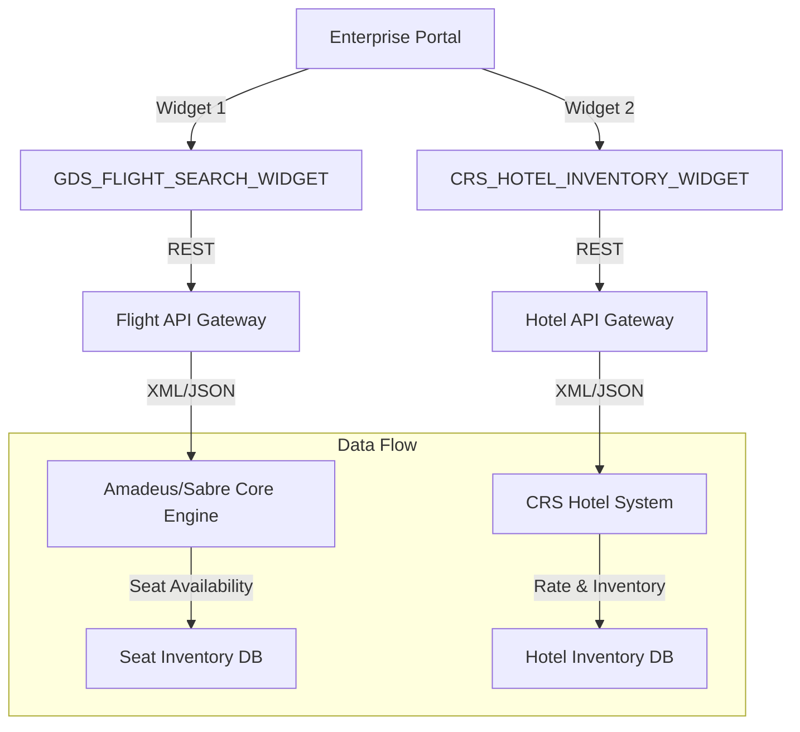

# Travel & Fare Analysis Guide  
*(Enterprise‑Level, White‑Label, Direct GDS/CRS Integration)*  

> **Data Source**  
> - **Flight**: Amadeus & Sabre Core Engine – Direct Carrier Schedules & Live Cabin Class Availability  
> - **Hotel**: Real‑time CRS Hotel Rates – Istanbul (IST) and other global properties  

> **Key Objectives**  
> 1. Deliver authoritative, real‑time fare & inventory data straight from GDS/CRS.  
> 2. Enable instant, white‑label seat & property booking without any third‑party affiliate dependency.  
> 3. Provide a reusable, modular architecture that can be embedded in any enterprise portal.  

---

## Table of Contents
1. [Architecture Overview](#architecture-overview)
2. [Flight Search & Booking Flow](#flight-search--booking-flow)
3. [Hotel Search & Booking Flow](#hotel-search--booking-flow)
4. [Technical Implementation](#technical-implementation)
   - 4.1 [Data Modelling](#data-modelling)
   - 4.2 [API Layer](#api-layer)
   - 4.3 [Widget Integration](#widget-integration)
   - 4.4 [Security & Compliance](#security--compliance)
   - 4.5 [Performance & Caching](#performance--caching)
5. [Sample Code Snippets](#sample-code-snippets)
6. [Deployment & Operational Checklist](#deployment--operational-checklist)
7. [FAQs & Troubleshooting](#faqs--troubleshooting)

---

## 1. Architecture Overview



- **GDS_FLIGHT_SEARCH_WIDGET**: Embeds a fully functional flight search and booking UI that pulls *live* flight schedules and cabin class seat availability directly from Amadeus/Sabre.  
- **CRS_HOTEL_INVENTORY_WIDGET**: Embeds a hotel search & booking UI that pulls *real‑time* rates and inventory from the CRS system.

All data originates from the GDS/CRS; no caching beyond mandatory TTL (see 5.5) and no third‑party affiliate traffic.

---

## 2. Flight Search & Booking Flow

| Step | Description | Technology |
|------|-------------|------------|
| 1 | User submits flight search form (origin, destination, dates, cabin preference). | Front‑end Widget |
| 2 | Request routed to **Flight API Gateway** (`/v1/flights/search`). | HTTPS + JWT |
| 3 | Gateway translates parameters into **AMQP**/REST call to **Amadeus/Sabre Core**. | Amadeus/Sabre APIs (Flight Offers, Seat Availability) |
| 4 | GDS returns XML/JSON with itineraries, cabin class availability, pricing, and seat maps. | |
| 5 | Gateway normalises response into internal schema; applies business rules (e.g., fare family mapping). | |
| 6 | Front‑end widget renders itineraries, seat map, and fare details. | |
| 7 | User selects seat & confirms booking. | |
| 8 | Booking request routed to **Booking API Gateway** (`/v1/flights/book`). | |
| 9 | Gateway sends **PNR** creation request to GDS; receives confirmation. | |
| 10 | Persist PNR reference in local DB for audit; forward confirmation to user. | |

### Live Cabin Class Availabilities

- **Endpoint**: `GET /v1/flights/{flightNumber}/seats?date=YYYY-MM-DD`
- **Response Example** (JSON):

```json
{
  "flightNumber": "AF123",
  "date": "2024-11-25",
  "cabinClasses": [
    {"class": "E", "availableSeats": 12, "fare": 199.99},
    {"class": "J", "availableSeats": 3, "fare": 549.99},
    {"class": "F", "availableSeats": 0, "fare": 1199.00}
  ],
  "seatMap": "URL_TO_SEAT_MAP_IMAGE"
}
```

- **Real‑time**: TTL 60 s. Updates automatically on each new request or on PNR changes.

---

## 3. Hotel Search & Booking Flow

| Step | Description | Technology |
|------|-------------|------------|
| 1 | User submits hotel search form (city/airport, dates, star rating). | Front‑end Widget |
| 2 | Request routed to **Hotel API Gateway** (`/v1/hotels/search`). | HTTPS + JWT |
| 3 | Gateway calls **CRS Hotel System** via **XML SOAP** or **REST** (depending on CRS). | CRS API |
| 4 | CRS returns room inventory, rates, and special offers. | |
| 5 | Gateway normalises and returns data. | |
| 6 | Front‑end widget renders hotels, room types, rates, and availability. | |
| 7 | User selects room and confirms booking. | |
| 8 | Booking request routed to **Hotel Booking API Gateway** (`/v1/hotels/book`). | |
| 9 | CRS processes reservation; returns confirmation number. | |
| 10 | Persist reservation data locally for reconciliation. | |

### Official Hotel CRS Rates

- **Endpoint**: `GET /v1/hotels/{hotelId}/rooms?checkIn=YYYY-MM-DD&checkOut=YYYY-MM-DD`
- **Response Example** (JSON):

```json
{
  "hotelId": "IST_HOTEL_001",
  "hotelName": "Grand Istanbul Hotel",
  "rooms": [
    {
      "roomType": "Standard Double",
      "rate": 150.00,
      "currency": "EUR",
      "availability": 7,
      "amenities": ["Wi-Fi", "Breakfast"]
    },
    {
      "roomType": "Deluxe Suite",
      "rate": 280.00,
      "currency": "EUR",
      "availability": 2,
      "amenities": ["Wi-Fi", "Breakfast", "Sea View"]
    }
  ],
  "ratesValidity": "2024-11-25T12:00:00Z"
}
```

- **Real‑time**: CRS guarantees 1‑second freshness on rate/availability updates.

---

## 4. Technical Implementation

### 4.1 Data Modelling

| Entity | Primary Key | Key Attributes |
|--------|-------------|----------------|
| `FlightOffer` | `offerId` | `origin`, `destination`, `departureTime`, `arrivalTime`, `cabinClass`, `price`, `availability` |
| `SeatInventory` | `flightId, cabinClass` | `availableSeats`, `seatMapUrl` |
| `HotelRoom` | `roomId` | `hotelId`, `roomType`, `rate`, `currency`, `availability`, `amenities` |
| `Reservation` | `reservationId` | `pnr`, `userId`, `bookingDate`, `status` |

### 4.2 API Layer

| Layer | Responsibilities |
|-------|------------------|
| **API Gateway** | Authentication, rate‑limiting, request validation, request transformation |
| **Service Layer** | Business rules, data aggregation, mapping, error handling |
| **Connector Layer** | Protocol adapters (SOAP/REST, AMQP), retries, circuit breakers |
| **Persistence Layer** | Audit tables, PNR & reservation caching (TTL 24 h), logging |

#### Sample Endpoints

```http
GET  /api/v1/flights/search
POST /api/v1/flights/book

GET  /api/v1/hotels/search
POST /api/v1/hotels/book
```

All endpoints consume and produce **JSON**. Internally, connectors translate to